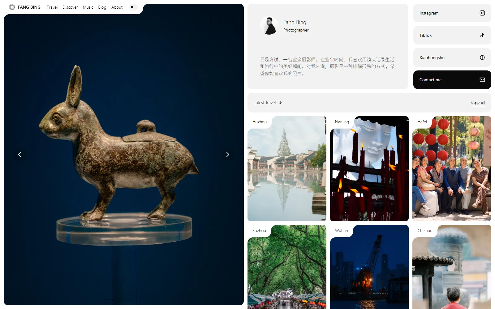
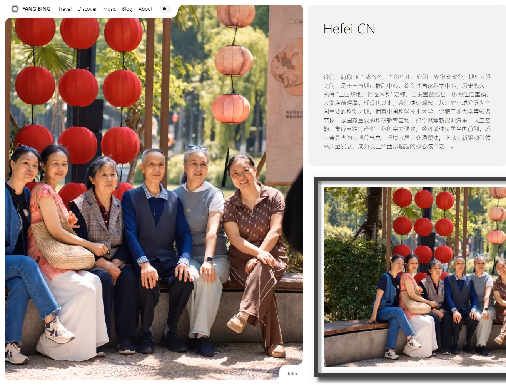
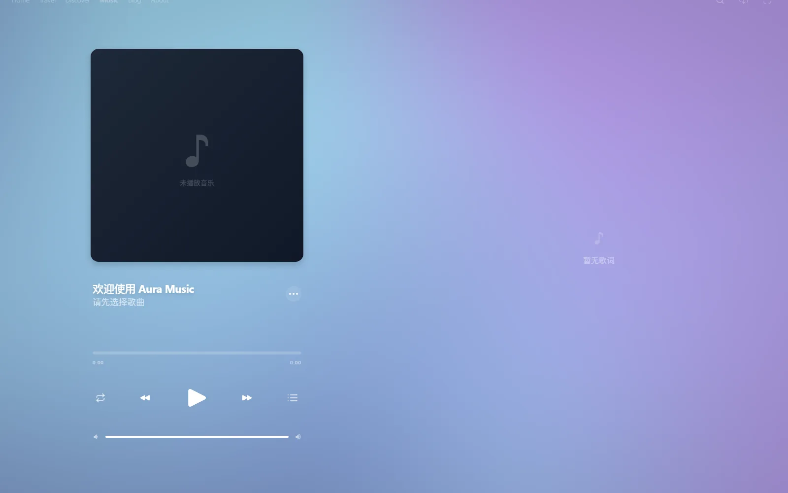
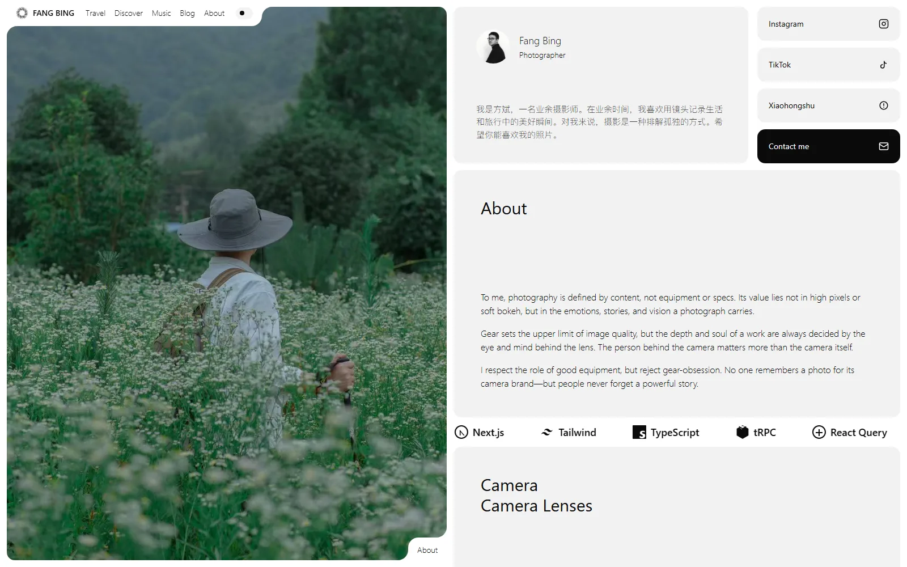
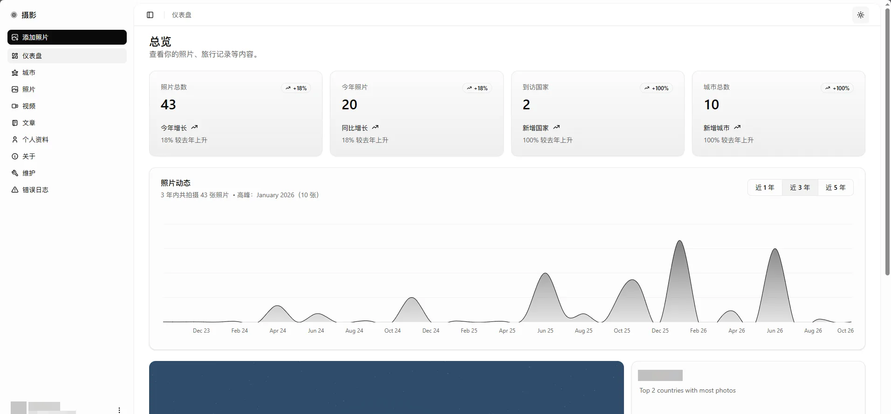

<div align="right">
  <a href="README.md"><b>English</b></a> · <a href="README.zh-CN.md">简体中文</a>
</div>

<h1 align="center">Fang Photography</h1>

<p align="center">
  A self-hosted photography portfolio, travel journal and music player — one Next.js app, end to end.
</p>

<p align="center">
  <a href="https://www.fangc.cc"><b>www.fangc.cc</b></a>
</p>

<p align="center">
  
</p>

## What this is

A personal site for a photographer: publish photos, group them into city collections, browse them on a map, write posts, and listen to music while you do it. The admin dashboard, upload pipeline, image delivery and error logging are all part of the same codebase — there is no CMS behind it.

Everything is designed around one constraint: **originals are huge** (3–18 MB RAW exports). Every image you see is generated on demand, cached at the CDN edge, and swapped for a blurhash placeholder while it loads.

## Features

**Photography**
- Full-bleed hero carousel, masonry city walls, immersive photo view with an EXIF overlay (camera, lens, focal length, aperture, shutter, date)
- BlurHash placeholders and dominant-colour backdrops, so a slow photo still looks intentional
- Keyboard navigation between photos, `next/image`-free on-demand variants

**Travel**
- City collections with full-screen covers, narrative intros and live photo counts
- Cover picker in the admin: star a photo to set the city cover, un-star to fall back to the newest public photo

**Music (Aura Music)**
- Search NetEase Cloud Music and stream through a same-origin proxy (`Range` / 206 supported)
- Synced lyrics, cover-colour theming, GLSL shader background, keyboard shortcuts, Media Session integration
- Optional NetEase cookie for VIP sources, with automatic mirror fallback when a CDN host refuses datacenter IPs

**Admin & operations**
- Dashboard with photo/post/video/city management and a city cover picker
- Error log viewer: JSONL on disk, searchable by source, level, day and keyword — mirrored by a CLI
- Multipart uploads (4 MiB chunks, HMAC-signed session, per-chunk retry) with a 99% "verifying" state instead of a lying progress bar
- `/api/health` returns the running `buildId`

**Platform**
- tRPC v11 end-to-end types, Drizzle ORM + PostgreSQL, better-auth sessions
- Nonce-based CSP, private photo visibility, SSRF guard on the lyric endpoint, rate-limited client error ingestion
- PM2 + nginx + Tencent Cloud CDN, PWA, RSS, sitemap, JSON-LD

## Screenshots

<table>
  <tr>
    <td width="50%"><br><sub><b>City collection</b> — full-screen cover, narrative intro, photo wall</sub></td>
    <td width="50%"><br><sub><b>Aura Music</b> — shader background, synced lyrics, NetEase search</sub></td>
  </tr>
  <tr>
    <td width="50%"><br><sub><b>About</b> — full-bleed portrait, gear list, stack badges</sub></td>
    <td width="50%"><br><sub><b>Admin dashboard</b> — stats, photo activity, country breakdown, CRUD for photos / posts / videos / cities, error logs</sub></td>
  </tr>
</table>

## Tech stack

| Layer | Choice |
|---|---|
| Framework | Next.js 16 (App Router) + React 19 |
| Language | TypeScript |
| API | tRPC v11 + Zod |
| Database | PostgreSQL (Neon) + Drizzle ORM |
| Auth | better-auth |
| Storage | S3-compatible (Tencent Cloud COS) + Tencent Cloud CI for on-the-fly processing |
| UI | Tailwind CSS v4 + shadcn/ui + Radix |
| Data fetching | TanStack Query v5 |
| State | Zustand |
| Motion / 3D | Framer Motion, Three.js + GLSL |
| Maps | Mapbox GL JS (same-origin proxy for tiles and geocoding) |
| Delivery | PM2 + nginx + Tencent Cloud CDN |

## Image pipeline

Originals stay untouched in object storage. Every rendered image goes through `/api/photo/v2/{id}?v={variant}`:

| Variant | Width | Quality | Used for |
|---|---|---|---|
| `thumb` | 400 px | 75 | tiny thumbnails |
| `fangb` | 800 px | 80 | cards, map markers, placeholders |
| `display` | 1920 px | 82 | carousels, photo detail, map popups |
| `hero` | 2560 px | 85 | full-height covers |

The handler asks the image service for `imageMogr2/thumbnail/{w}x/format/webp/quality/{q}/strip`, falls back to a named style and then to the original. Responses are `immutable` for a year — which is why the route is versioned in the **path** (`/v2/`) rather than with a query string: the CDN ignores query parameters when building cache keys.

## Architecture

```
src/
├── app/
│   ├── (home)/            # landing, about, blog, music, discover
│   ├── (photograph)/      # /p/[id] photo view
│   ├── (dashboard)/       # admin area
│   └── api/               # tRPC, photo proxy, upload, music, logs
├── modules/               # feature modules (photos, cities, travel, music, s3, …)
│   ├── */server/          # tRPC routers + business logic
│   ├── */ui/              # views and components
│   └── */lib/             # shared helpers
├── components/            # design system + AuraMusic player
├── db/                    # Drizzle schema and clients
└── lib/                   # logger, photo proxy, music providers
scripts/                   # audits, log CLI, seed
```

## Getting started

```bash
git clone https://github.com/Fangcbb/photography-website.git
cd photography-website
npm install
npm run db:push      # apply the Drizzle schema
npm run dev
```

### Environment

| Variable | Needed for | Notes |
|---|---|---|
| `DATABASE_URL` | everything | PostgreSQL connection string |
| `BETTER_AUTH_SECRET` | auth | session signing key |
| `NEXT_PUBLIC_APP_URL` | auth, tRPC | public origin, e.g. `https://www.fangc.cc` |
| `S3_ENDPOINT` / `S3_BUCKET_NAME` / `S3_ACCESS_KEY_ID` / `S3_SECRET_ACCESS_KEY` | uploads | any S3-compatible store |
| `NEXT_PUBLIC_S3_PUBLIC_URL` | images | public/CDN base URL |
| `NEXT_PUBLIC_MAPBOX_ACCESS_TOKEN` | `/discover` | Mapbox token |
| `MUSIC_API_BASE` | `/music` | self-hosted NetEase proxy |
| `MUSIC_U`, `MUSIC_R_U`, `MUSIC_R_T`, `MUSIC_A_T` | optional | NetEase cookie fields for VIP sources |
| `NEXT_PUBLIC_GA_ID` | optional | GA4 |
| `LOG_DIR` | optional | where JSONL error logs are written (`~/logs` by default) |

### Build & run

```bash
export BETTER_AUTH_SECRET=build-only-placeholder-not-for-runtime
npm run build
pm2 start npm --name photo -- start -- -H 127.0.0.1
```

Two things bite people here:

- `NEXT_PUBLIC_*` values are inlined at build time — changing them requires a rebuild, not a restart.
- `next start` ignores the `HOSTNAME` environment variable; bind explicitly with `-H`. And `pm2 restart` does not reload standalone output, so use `pm2 delete` + `pm2 start` after a build.

## Scripts

| Command | What it does |
|---|---|
| `npm run dev` | dev server |
| `npm run build` | production build (webpack, PWA, strips source maps) |
| `npm run lint` / `test` | lint / unit tests |
| `npm run db:push` / `db:studio` | apply schema / browse data |
| `npm run photos:audit` | check every photo record against storage |
| `npm run photos:audit:fix` | re-link records to orphan files by camera filename |
| `npm run logs` / `logs:summary` | query the JSONL error log from the CLI |

## License

[MIT](LICENSE) © Fang Bing
